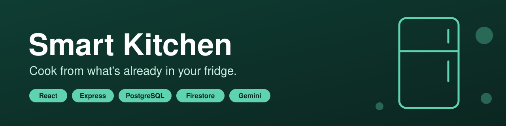
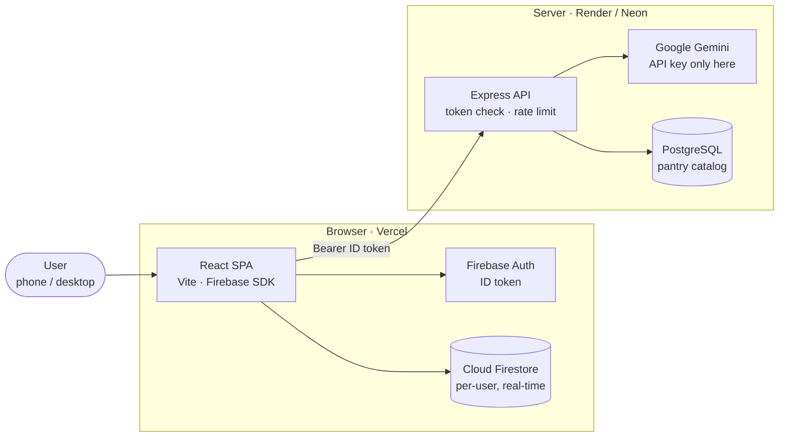

<p align="center">
  
</p>

<p align="center">
  <a href="https://github.com/KovyD20/receptor/actions/workflows/ci.yml"></a>
  
  
  
  
  
  
  
</p>

**An AI kitchen assistant** that tracks your fridge, scales recipes, builds the shopping
list and asks Gemini what to cook from what you already have.

<!-- Hero GIF (15–20 s): fridge → "what should I cook?" → Gemini recipe → missing items to the list → "Hűtőbe rak".
<p align="center"></p>
-->

## Features

<!-- Three phone screenshots (390×844), same recipe on all three:
<p align="center">
  
  
  
</p>
-->

- **Fridge** – items grouped into pantry categories automatically, with amount/unit steppers.
- **Recipes and cook mode** – amounts rescale with the serving count; cook mode reads step by step from across the kitchen.
- **Shopping list** – "2 dl" added to "1 l" merges instead of duplicating; one action moves the whole list into the fridge.
- **AI recipes** – by dish name, from your fridge contents, or imported from any recipe URL (schema.org JSON-LD first, page text as fallback).
- **Keyboard and images** – every view is keyboard-navigable; recipe photos upload to Firebase Storage as 1200 px WebP.

## Architecture



The browser talks to Firestore **directly**: that is what makes real-time sync work, and
Firestore security rules scope access per user. The Express service exists for the two
things a browser must not do: hold the Gemini API key, and query PostgreSQL.

| Data | Store | Why |
|---|---|---|
| Fridge, recipes, shopping list | **Cloud Firestore** | private per user, real-time push (`onSnapshot`), user-scoped rules |
| Pantry catalog (categories, items, aliases) | **PostgreSQL** | global, shared, relational, unique normalized keys |

The catalog's `normalized_key` columns are computed at seed time by
[`backend/lib/normalize.js`](backend/lib/normalize.js), and runtime text is normalized by
that **same module**, so stored keys and lookups cannot drift apart.

## Engineering highlights

| | |
|---|---|
| **801** | Vitest tests, all green (backend 192 + frontend 609) |
| **2** | databases, split on purpose: Firestore for per-user data, PostgreSQL for the shared catalog |
| **4** | AI endpoints, each validated with `zod` and rate limited per user |
| **CI** | lint, tests and build for both workspaces on every push and pull request |

## How I built this

I specified the features and the data split myself and used AI assistants for much of the
implementation, reviewing and refactoring what they produced. The AI layer was rebuilt
once on `@google/genai` with retries and typed errors, so the UI can say which quota ran
out instead of failing silently. Recipe import tries the page's schema.org JSON-LD first
and only falls back to raw page text, and the prompt forbids inventing ingredients that
are not on the page. Seed-time keys and runtime lookups share one normalization module,
so they cannot drift apart. The pantry seed upserts by default, and the truncating reset
is a separate command that prints the target database before it writes.

<details>
<summary><b>Built with</b></summary>

| Layer | Technology |
|---|---|
| Frontend | React 19, Vite 7, Three.js (animated background), Firebase JS SDK |
| Backend | Node.js 22, Express 5, `pg`, `zod`, `helmet`, `express-rate-limit`, `firebase-admin` |
| Databases | PostgreSQL 16 (pantry catalog), Cloud Firestore (per-user data) |
| Auth and files | Firebase Authentication, Firebase Storage |
| AI | Google Gemini (`AI_MODEL`, default `gemini-3.6-flash`) via `@google/genai` |
| Tests / CI | Vitest, GitHub Actions |

Icons are inlined Font Awesome Free SVG paths; no icon webfont is shipped.

</details>

<details>
<summary><b>Getting started</b></summary>

The app runs as **two processes**: the Express API and the Vite dev server. You also need
a PostgreSQL instance and a Firebase project.

### Prerequisites

- **Node.js 22** (or 18+)
- **PostgreSQL 16**: local, a Docker container, or a free managed instance
  ([Neon](https://neon.tech/) / [Supabase](https://supabase.com/))
- A **Google Gemini API key**, free at [Google AI Studio](https://aistudio.google.com/app/apikey)
- A **Firebase project** from the [Firebase Console](https://console.firebase.google.com/) with
  - **Authentication**: *Email/Password* and *Google* enabled
  - **Firestore** and **Storage** created, restricted to the signed-in owner (rules below)
  - **Project Settings → Service accounts → Generate new private key**, so the backend can verify ID tokens

<details>
<summary>Firestore and Storage security rules</summary>

```
rules_version = '2';
service cloud.firestore {
  match /databases/{database}/documents {
    match /users/{uid}/{document=**} {
      allow read, write: if request.auth != null && request.auth.uid == uid;
    }
  }
}
```

The Storage size cap is the second line of defence: the client already re-encodes every
picked image to WebP at 1200 px, which puts a phone photo well under 2 MB.

```
rules_version = '2';
service firebase.storage {
  match /b/{bucket}/o {
    match /recipes/{uid}/{allPaths=**} {
      allow read: if request.auth != null && request.auth.uid == uid;
      allow write: if request.auth != null
                   && request.auth.uid == uid
                   && request.resource.size < 2 * 1024 * 1024
                   && request.resource.contentType.matches('image/.*');
      allow delete: if request.auth != null && request.auth.uid == uid;
    }
  }
}
```

</details>

### Installation

**1. Clone and install**

```bash
git clone https://github.com/KovyD20/receptor.git
cd receptor
(cd backend && npm install)
(cd frontend && npm install)
```

**2. Configure the backend**

```bash
cp backend/.env.example backend/.env
```

Fill in the PostgreSQL connection, `GEMINI_API_KEY`, and the three `FIREBASE_*` values from
the service-account JSON. Every variable is documented inline in the example file.

> The Gemini key lives **only** here. The frontend bundle is public, so a key there could be
> lifted and your quota burned. This is the main reason a separate backend exists at all.

**3. Configure the frontend**

```bash
cp frontend/.env.local.example frontend/.env.local
```

Fill in the `VITE_FIREBASE_*` values from Firebase Console → Project Settings → Your apps.
Without `VITE_FIREBASE_STORAGE_BUCKET` the app runs but every image upload fails. Leave
`VITE_API_BASE_URL` **empty** locally: Vite's dev proxy forwards `/api` to `localhost:3000`.

**4. Create and seed the pantry catalog**

```bash
cd backend
npm run db:setup     # applies db/schema.sql, then seeds the catalog
```

`npm run migrate` and `npm run seed` can also run separately and are safe to re-apply: the
schema is idempotent and seeding **upserts**. `npm run seed:reset` **truncates the catalog
tables** first, to match the seed data exactly. Both modes print the target host, port and
database before writing, so check that line: they write to whatever `DB_*` points at.

### Running the app

```bash
# Terminal 1: API on :3000
cd backend && npm run dev

# Terminal 2: SPA on :5173
cd frontend && npm run dev
```

Open **http://localhost:5173**, sign in, and use the five tabs: **Receptek** (browse),
**Recept** (selected recipe, servings, cook mode), **Bevásárlólista**, **Hűtő** and
**Új recept** (by hand, by AI, or from a URL). The header search covers recipes and list
items and is accent-insensitive: `turos` finds *Túrós csusza*.

</details>

<details>
<summary><b>API endpoints</b></summary>

| Method | Path | Auth | Description |
|---|---|---|---|
| `GET` | `/health` | – | Liveness probe; returns `INSTANCE_NAME`, no DB access |
| `GET` | `/api/db/health` | – | Readiness probe; confirms PostgreSQL connectivity |
| `GET` | `/api/pantry/catalog` | – | Full pantry catalog (categories → items → aliases) |
| `POST` | `/api/ai/recipe-by-name` | Bearer | Generate a recipe from a dish name |
| `POST` | `/api/ai/suggest-from-fridge` | Bearer | Suggest dish ideas from fridge contents |
| `POST` | `/api/ai/recipe-from-fridge` | Bearer | Generate a full recipe restricted to fridge contents |
| `POST` | `/api/ai/recipe-from-url` | Bearer | Import a recipe from a web page (JSON-LD, else page text) |

`Bearer` means a Firebase ID token in `Authorization: Bearer <token>`. These routes are
rate limited to **20 requests per 15 minutes per user**, and request bodies are validated
with `zod`. Recipe, fridge and shopping-list CRUD is **not** here: the client does that
against Firestore directly. `restclient-test.http` has ready-made requests for the VS Code
REST Client extension.

</details>

<details>
<summary><b>Testing</b></summary>

```bash
cd backend  && npm test        # 192 tests
cd frontend && npm test        # 609 tests
cd frontend && npm run lint
```

Coverage focuses on the real business logic (unit conversion and merging, catalog
normalization and alias resolution, recipe import, Gemini error and JSON handling)
rather than a coverage percentage. [GitHub Actions](https://github.com/KovyD20/receptor/actions/workflows/ci.yml)
runs lint, tests and build for both workspaces on every push and pull request to `master`.

</details>

<details>
<summary><b>Deployment</b></summary>

All free tier, all auto-deploy on push:

| Part | Host | Config in repo |
|---|---|---|
| Frontend (React build) | **Vercel** | [`frontend/vercel.json`](frontend/vercel.json) |
| Backend (Express) | **Render** | [`render.yaml`](render.yaml) blueprint |
| PostgreSQL (pantry catalog) | **Neon** | connection string → `DB_*` vars |
| Auth, per-user data, images | **Firebase** | free tier |

Point Render at the repo and it creates the service from `render.yaml`, prompting once for
the values marked `sync: false`, so no secret is committed.

Render's free tier spins the service down after 15 idle minutes and takes 30–60 s to wake.
That only delays the catalog fetch and the first AI call; sign-in and your own data go
straight to Firebase. A 10-minute keep-warm ping to `/health` removes the delay.

</details>

<details>
<summary><b>Local Docker demo (archived)</b></summary>

An earlier iteration ran the whole stack in Docker Compose: Nginx as reverse proxy and
round-robin load balancer over **two** backend replicas, plus a PostgreSQL container. It is
kept in [`archive/`](archive/) as a self-contained infrastructure demo:

```
archive/
├── docker-compose.yml           # nginx + backend1 + backend2 + postgres
├── backend/Dockerfile
├── infra/nginx/nginx.conf       # reverse proxy + upstream load balancing
├── infra/postgres/init.sql      # superseded by backend/db/schema.sql
└── scripts/                     # logs, restart, in-container helpers
```

Both replicas report their own `INSTANCE_NAME` from `/api/db/health`, so hitting it
repeatedly shows Nginx round-robining between them. **This is not the current way to run
the app**: it predates the Firestore/PostgreSQL split, so the compose files need updating
before they run again.

</details>

## Roadmap

- [ ] Public recipe library as a second PostgreSQL domain, browsable without signing in,
      with likes and full-text search over names and ingredients
- [ ] Live public demo link
- [ ] Expiry-date tracking for fridge items
- [ ] Component-level frontend tests (Testing Library)
- [ ] Backend integration tests against a Postgres service container in CI

## License

Distributed under the MIT License.
